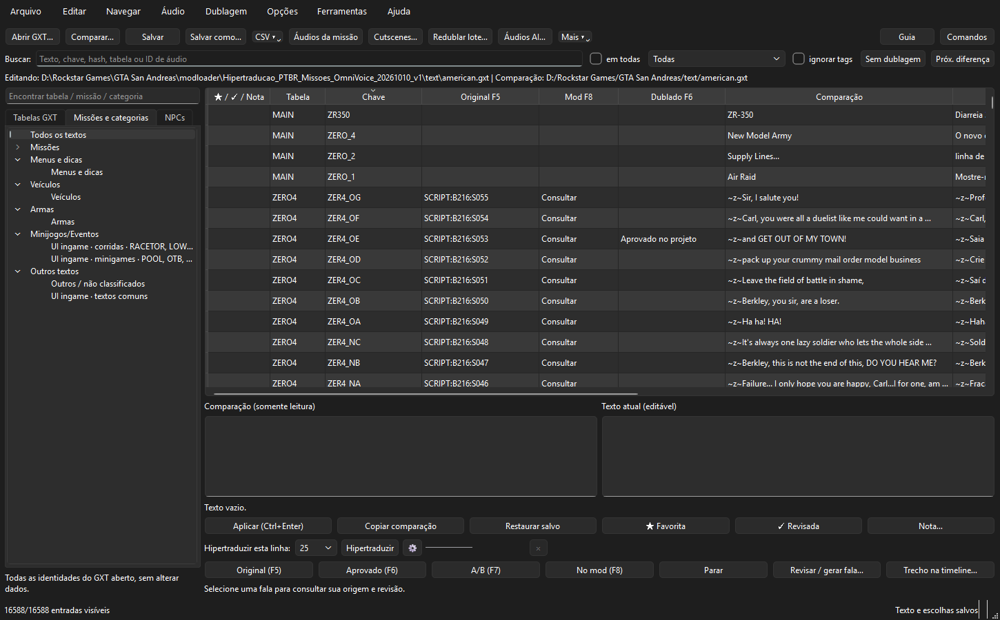
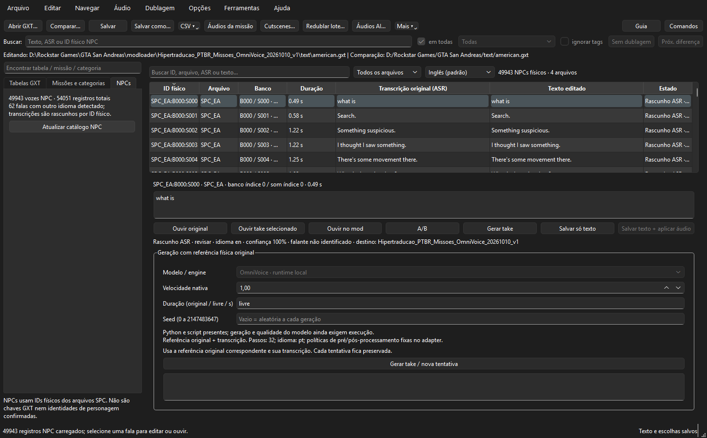
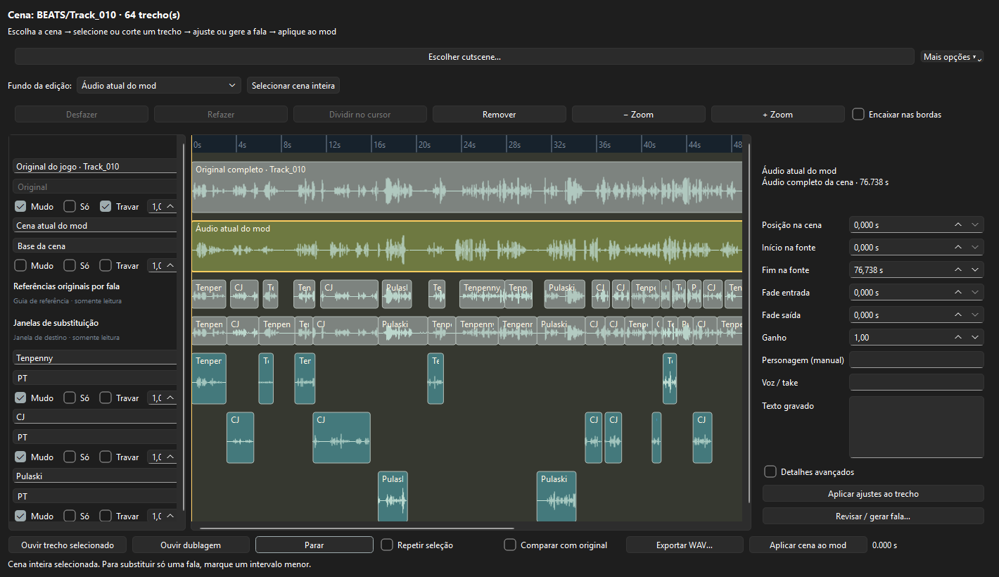
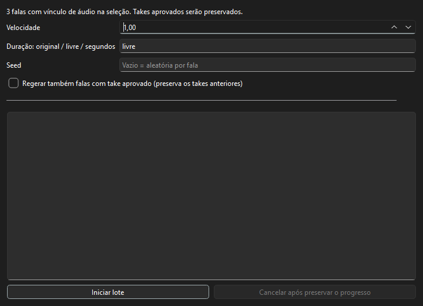

# GXT Mission Audio Studio

Editor de textos, revisão de voz e timeline de áudio para **GTA San Andreas clássico de PC**.
Interface principal em **PySide6/Qt**, com a variante Tkinter preservada.



## Recursos

- Edição GXT com comparação, validação, histórico, busca, duplo clique e menu contextual.
- Navegação por missões, menus/dicas, veículos, armas, minijogos/eventos e outros textos.
- Audição separada do original, áudio atual do ModLoader e take gerado; comparação A/B.
- Vínculos físicos de SCRIPT, SPC, BEATS e CUTSCENE, com tratamento próprio de bancos e streams.
- Timeline de cutscenes com camadas, seleção de trechos e referências da fala original.
- Geração local com OmniVoice, parâmetros por fala, seed aleatória e lote retomável.
- Salvar combina textos e takes escolhidos; arquivos existentes ficam preservados quando não há substituição.
- Catálogo NPC por arquivo/banco/som, transcrição original separada do texto editado e filtros de idioma.
- Hipertradução da linha selecionada, com configuração do serviço e quantidade de etapas.

## Instalação

Recomendado: **Windows 10/11, Python 3.13 de 64 bits** e uma cópia local do jogo.
Os arquivos do jogo, SAAT, FFmpeg, pesos de IA e runtimes CUDA **não estão incluídos**.

```powershell
git clone https://github.com/Hirothewolf/gxt-mission-audio-studio.git
cd gxt-mission-audio-studio
py -3.13 -m venv .venv
.\.venv\Scripts\python.exe -m pip install -e .
.\.venv\Scripts\python.exe gxt_editor_qt.py
```

Depois da instalação, `Abrir Editor Qt.cmd` usa a `.venv` local. A versão clássica abre com
`Abrir Editor.cmd`. Para configurar os arquivos do jogo e o projeto, veja [o guia de uso](docs/USAGE.md).

**A instalação básica abre o editor; ela não instala ou baixa modelos de voz.**
Configure o ambiente OmniVoice separadamente na janela de modelos e indique sua raiz de projeto.
Adaptadores legados Qwen/Chatterbox dependem dos scripts/runtimes externos configurados.
A presença de pesos não equivale a um runtime de síntese funcional.

## Capturas

### Catálogo NPC e revisão



### Timeline de cutscene



### Geração em lote



Capturas reais de testes locais. Elas mostram um projeto de exemplo; o repositório não contém
os áudios, o GXT, as transcrições completas nem os dados de trabalho mostrados nas telas.

## Estado e desenvolvimento

Projeto experimental. As transcrições ASR e atribuições sugeridas não comprovam personagem ou qualidade vocal.
O catálogo NPC requer um catálogo local recuperado/validado; uma instalação nova não recebe automaticamente
as 54 mil transcrições do projeto de demonstração.

- [Guia de uso](docs/USAGE.md)
- [Desenvolvimento e testes](docs/DEVELOPMENT.md)
- [Dependências e dados locais](docs/DEPENDENCIES.md)
- [Verificação desta publicação](docs/VERIFICATION.md)
- [Créditos e componentes externos](THIRD_PARTY_NOTICES.md)

## Licença

Nenhuma licença de código foi escolhida para esta primeira publicação. Publicar este repositório
não concede uma licença sobre GTA San Andreas, vozes, modelos ou dependências de terceiros.
As atribuições dos metadados incluídos estão em `THIRD_PARTY_NOTICES.md`.
